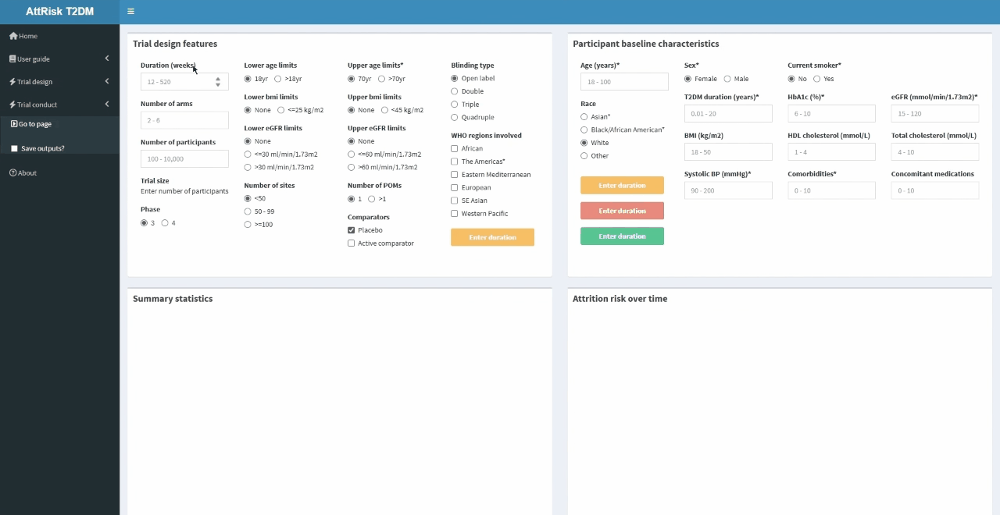
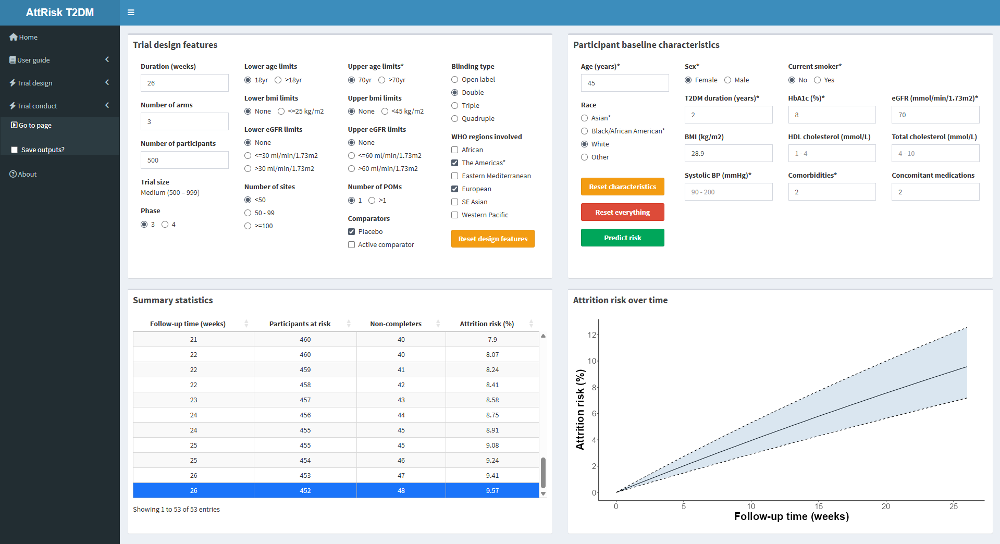
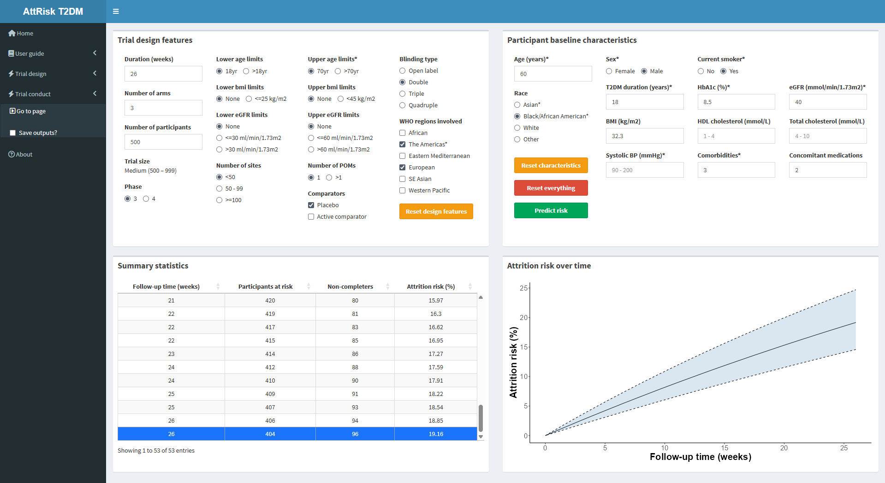
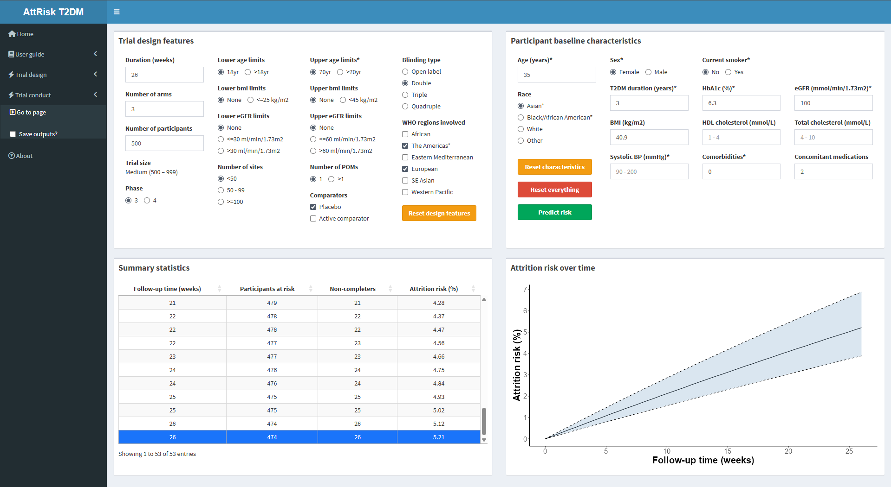

### **Scenario**

Following the example for **Trial design features**, a team of trialists have designed a randomised controlled trial to evaluate the efficacy of a newer antidiabetic in people with type 2 diabetes.

The team have agreed on the following design features:

- Phase 3, double-blinded trial
- Three treatment arms: Two experimental (different doses of the newer antidiabetic) and a placebo
- Participants will be recruited in North America and Europe
- 26 weeks of follow-up
- Ideally 500 randomised participants
- Minimum age of 18yrs, maximum age of 70yrs
- No limits on BMI or EGFR
- <50 sites
- One primary outcome (change from baseline HbA1c)

The team have decided to focus retention efforts at the early stages of the trial because AttRisk indicated that attrition might occur most at this stage.

The team are now considering how attrition might occur in the trial for different types of participants who could be enrolled. They use AttRisk to evaluate this by building different types of participant profiles.

 

### **Participant scenario #1**

The team first consider what attrition might look like for a middle-age participant with multimorbidity who was recently diagnosed with type 2 diabetes. They settle on the following characteristics profile:

- 45 year old white female who used to smoke tobacco (no longer does)
- Diagnosed with T2DM 2 years ago, overweight (BMI 28.9)
- Has hyperglycaemia (HbA1c 8%), blood glucose is inadequately controlled by maintenance antidiabetics
- Has stage 2 kidney disease (eGFR <90ml/min/1.732)
- Has COPD and migraines, takes a nebuliser and a medication to manage these conditions

The team input these characteristics and generate outputs of attrition risk.

{width="1100"}

The outputs indicate to the team that the risk of attrition is approximately 9.6% by the end of follow-up.

{width="1100"}

 

### **Participant scenario #2**

The team next consider what attrition might look like for a participant with multimorbidity who is male, of a different racial identity and has had T2DM for a longer period of time:

- 60 year old African American male who current smokes tobacco
- Diagnosed with T2DM 18 years ago, obese (BMI 32.3)
- Has hyperglycemia (HbA1c 8.5%), inadequately controlled by maintenance antidiabetics
- Has stage 3 kidney disease (eGFR <60ml/min/1.73m2)
- Has hypertension, gout and fatty liver disease, takes medications for hypertension and gout

The outputs indicate that a participant with this characteristics profile has a considerably higher risk of attrition (approximately 19%) by the end of follow-up.

{width="1100"}

 

### **Participant scenario #3**

The team then consider what attrition might look like for a younger participant who was recently diagnosed with T2DM:

- 35 year old Asian female who does not smoke tobacco
- Diagnosed with T2DM 3 years ago, class III obesity (BMI 40.9)
- Blood glucose is adequately controlled by maintenance antidiabetics (HbA1c 6.3%)
- Does not have kidney disease (>90ml/min/1.73m2)
- Does not have any comorbidities but takes two supplements

The outputs indicate to the team that the risk of attrition is lowest for this participant (approximately 5.2%) by the end of follow-up.

{width="1100"}
