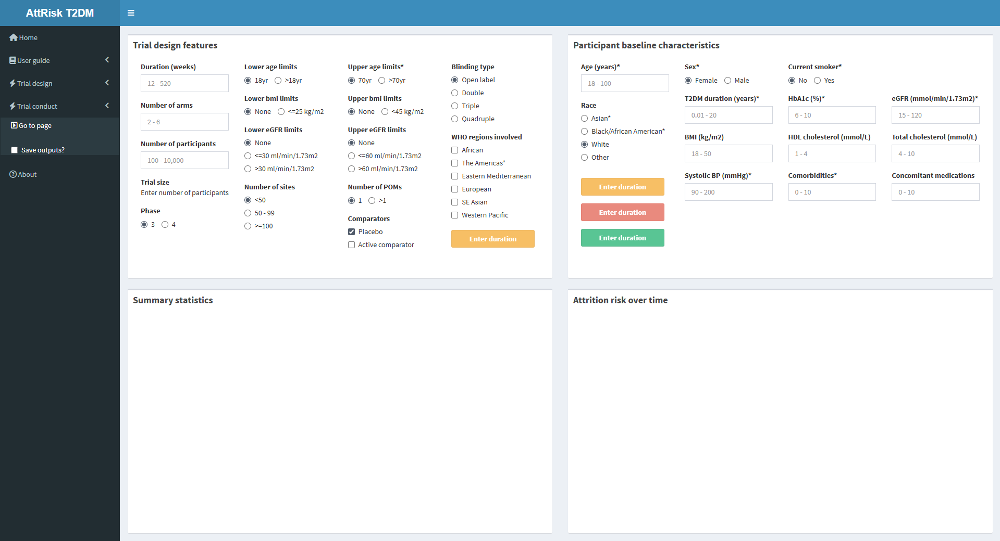
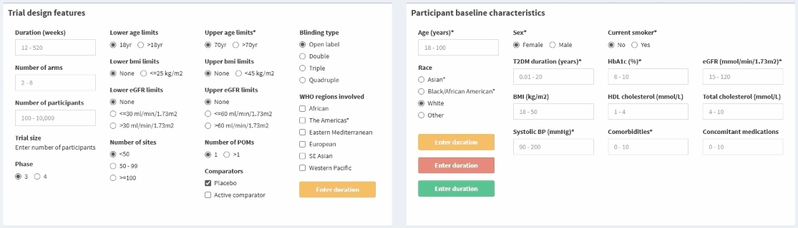
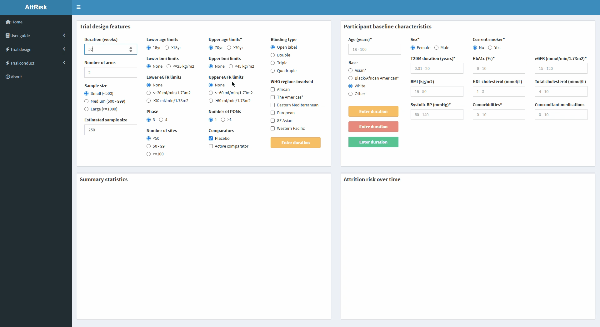
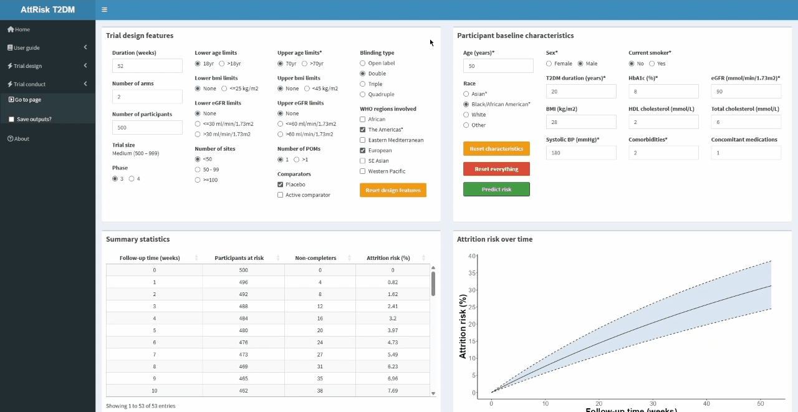

### **Using the trial conduct interface**

Upon clicking **Trial conduct** in the sidebar, you will be greeted with the interface.

{width="1100"}

Two buttons controlling the interface are found at the bottom of **Box A**:

-   **Reset inputs** - Resets the design feature and characteristic inputs
-   **Reset everything** - Resets the conduct interface (i.e. clear inputs and outputs)
-   **Predict risk** - Initiates interface to generate outputs

By default, all buttons are disabled until duration and age have been entered. Each button will display the required input (e.g. if duration is entered, each button displays **Enter age**). 

Once duration and age are entered, the buttons will activate.

{width="550"}

After pressing **Predict risk**, outputs will be generated in boxes C and D after a couple of seconds.

{width="1100"}

### **Save the generated outputs**

The dropdown menu for **Trial conduct** also has a checkbox labelled **"Save outputs?"**.

When selected, a series of additional checkboxes will appear allowing for the plots and summary statistics to be downloaded.

After selecting the desired outputs to save, press **Save outputs**. A loading bar in the bottom-right corner of the interface indicating the preparation of outputs.

Shortly after, a popup will appear indicating that the outputs are ready to download. Click **Download zip** to save the outputs to your computer.

{width="1100"}

Click **Close** to return to the interface.

