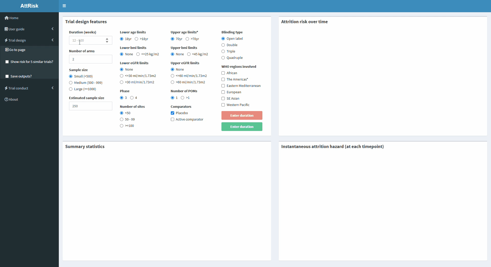
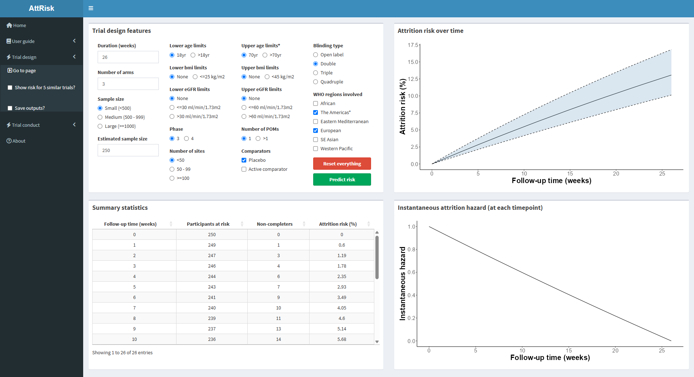
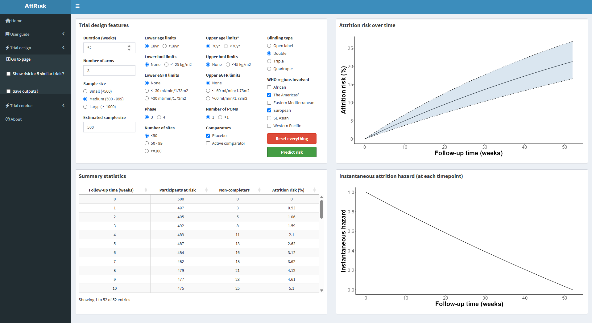

### **Scenario**

A team of trialists are in the early stages of designing a randomised controlled trial evaluating the efficacy of a newer antidiabetic in people with type 2 diabetes.

So far, the team has agreed to the following:

-   The trial will be phase 3 and double-blinded
-   There will be three treatment arms: Two experimental (different doses of the newer antidiabetic) and one comparator
-   Participants will be recruited from sites in North America and Europe
-   Eligible age groups: 18-70

They are now considering: 

- How long the trial should be 
- How many participants should be recruited 
- Which comparator to use in the third arm

Additionally, the team are considering how attrition can be minimised. 

To inform decision making, they use AttRisk to evaluate how attrition might occur using the agreed set of features, and experimenting with options for the remaining features.

### **Application of AttRisk**

The team first consider a 26-week trial where the comparator arm is a placebo. Inputting this into AttRisk in combination with the agreed design features and defaults, the features are:

- Phase 3, double-blinding, three treatment arms
- Sites in North America and Europe
- 26 weeks of follow-up, placebo comparator
- Small trial size (<500) with an estimated 250 participants
- Minimum age of 18yrs, maximum age of 70yrs
- No limits on BMI or eGFR
- <50 sites
- One primary outcome

The team then generate outputs of attrition risk for this set of design features.

{width="1100"}

From this trial setup, the team can see that:

1. Attrition is most likely to occur at the beginning of the trial (Box C)
2. Approximately 13% attrition is expected by the end of follow-up (Box B)

{width="1100"}

They save the outputs to be used in future decision making.

They next consider what the outlook for attrition will look like if the trial was 52 weeks long and had a larger number of participants. They keep all other design features the same, changing duration to 52 weeks and the sample size to medium (500 - 999), with an estimated 500 participants.

From this setup, the team see that:

1. Attrition is still most likely to occur at the beginning of the trial
2. By 52 weeks, approximately 21% attrition is expected

{width="1100"}

They save these outputs for comparison to the 26-week, smaller trial for decision making around retention (e.g. implementing strategies at the beginning of the trial).