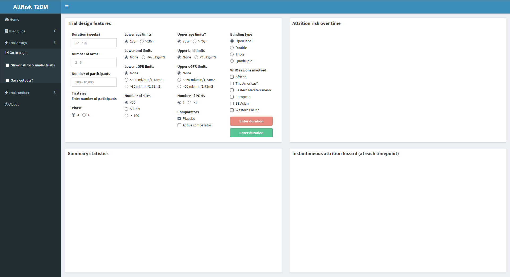
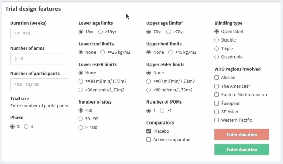
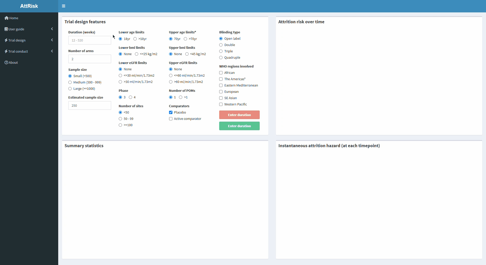
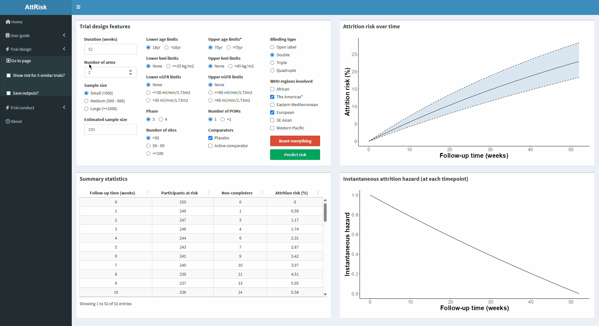
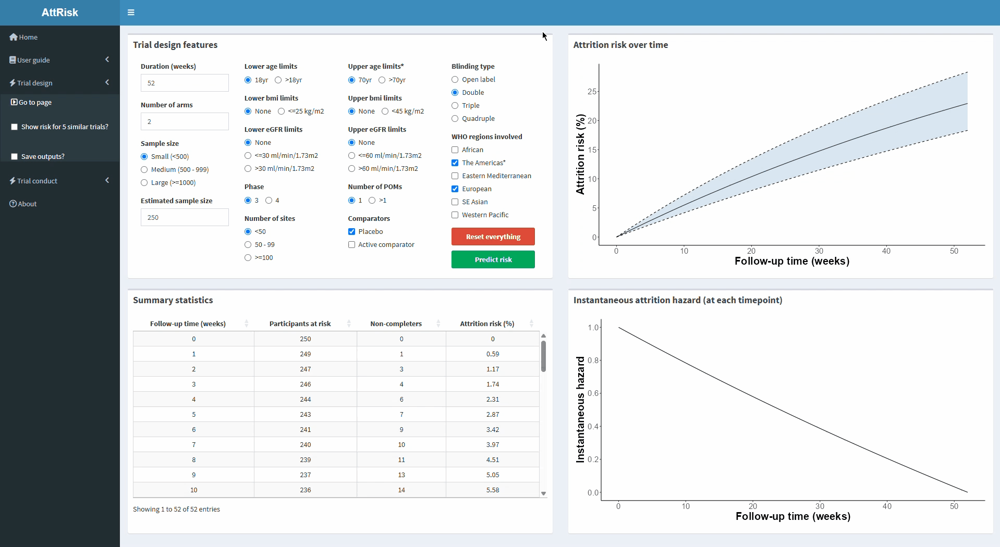
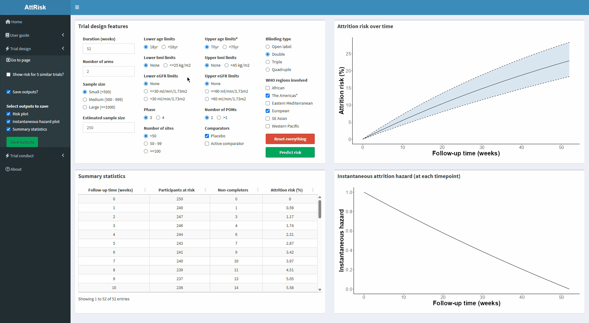

### **Using the trial design interface**

Upon clicking **Trial design** in the sidebar, you will be greeted with the empty interface.

{width="1100"}

Two buttons controlling the interface are found at the bottom of **Box A**:

-   **Reset everything** - Resets the design interface (i.e. clear inputs and outputs)
-   **Predict risk** - Initiates interface to generate outputs

By default, both buttons are disabled until duration has been entered (this is required to generate outputs). Each button will display **Enter duration** to indicate this. 

Once duration is entered, the buttons will activate.

{width="550"}

After pressing **Predict risk**, outputs will be generated in boxes B, C and D after a couple of seconds.

{width="1100"}

 

### **Compare outputs to previously conducted, real-world trials**

The dropdown menu for **Trial design** in the sidebar has a checkbox labelled **"Show risk for 5 similar trials?"**. 

When selected, this will add markers to the plot in **Box B** indicating risk for trials with similar design features that are registered on ClinicalTrials.gov.

When selected, the total risk (%) and ClinicalTrials.gov identifiers for the 5 trials will appear below the checkbox. Each trial hyperlinks to the respective ClinicalTrials.gov registration.

{width="1100"}

 

### **Save the generated outputs**

The dropdown menu for **Trial design** also has a checkbox labelled **"Save outputs?"**.

When selected, a series of additional checkboxes will appear allowing for the plots and summary statistics to be downloaded.

An Excel CSV file will be saved by default with any selected output. This contains the design features inputted to generate the outputs (**design_features.csv**)

After selecting the desired outputs to save, press **Save outputs**. A loading bar in the bottom-right corner of the interface indicating the preparation of outputs.

Shortly after, a popup will appear indicating that the outputs are ready to download. Click **Download zip** to save the outputs to your computer.

{width="1100"}

Click **Close** to return to the interface.

If **"Show risk for 5 similar trials?"** is selected, the downloadable outputs will include a summary of total risk (%) and the ClinicalTrials.gov identifiers for the 5 most similar trials (**5_similar_trials.csv**).

{width="1100"}

