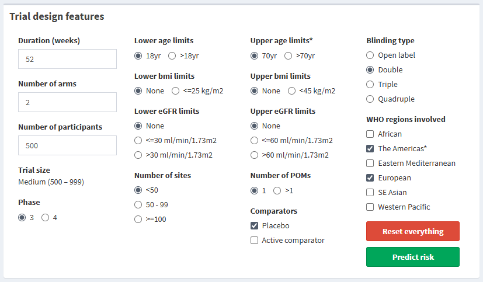
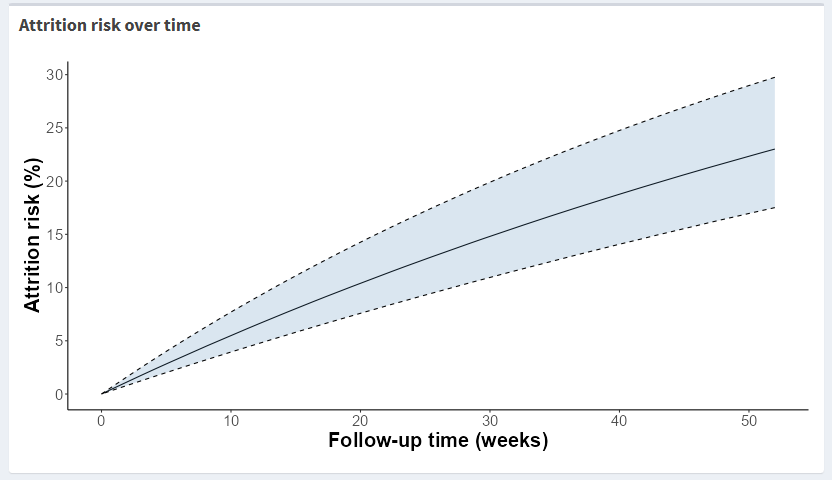
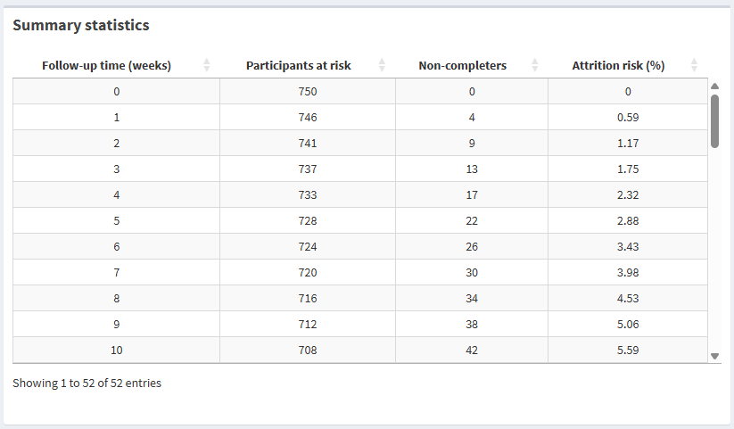
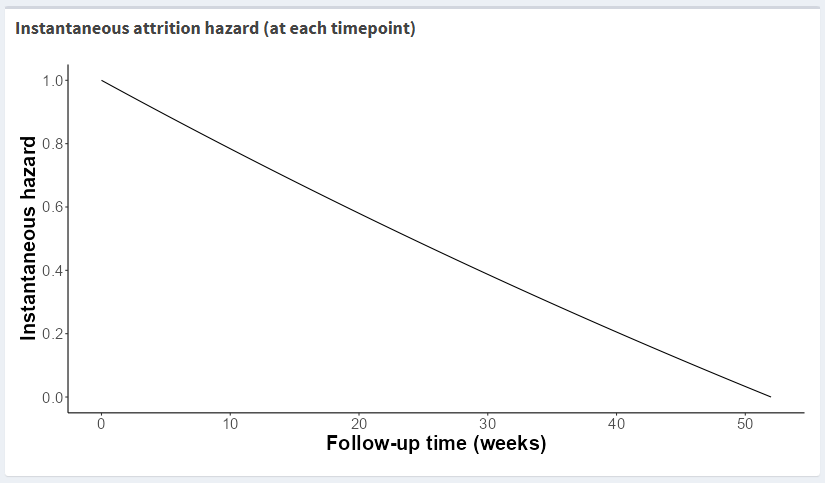

### **Trial design interface in action**

{width="1100"}

The interface has the following features:

- **Box A (top-left)** - Trial design features
- **Box B (top-right)** - Attrition risk over time
- **Box C (bottom-left)** - Summary statistics
- **Box D (bottom-right)** - Instantaneous attrition hazard (at each timepoint)

<br>

### **Trial design features**

**Box A** displays the inputs for trial design features. Most features have a default value set upon opening the interface, but these can be changed by selecting the other available options for a feature. 

Features with an astrix beside the name indicate a significant predictor of attrition risk.

{width="750"}

The available set of trial design inputs are:

```{r echo = FALSE}
tbl_design <- dplyr::tibble(
  Features = c(
    "Duration", "Number of arms", "Number of participants", "Trial size",
    "Age limits", "BMI limits", "eGFR limits", "Phase", "
    Number of primary outcomes (POMs)", "Comparators",
    "Blinding type", "WHO regions involved"
  ),
  Description = c(
    "Duration of trial follow-up in weeks", "Number of treatment arms",
    "Total number of randomised participants", 
    "Trial size (based on inputed total number of participants)",
    "Upper and lower age limits", "Upper and lower BMI limits",
    "Upper and lower estimated glomerular filtration rate (eGFR) limits",
    "Trial phase", "Number of primary outcomes", "Comparator treatment groups",
    "Level of blinding", "World Health Organisation (WHO) regions involved"
  ),
  `Categories and limits` = c(
    "12 to 520 weeks", "2 to 6 arms", 
    "100 to 10,000 randomised participants",
    "Based on number of participants: Small (<500), Medium (500 - 999), Large (>=1000)",
    "Upper: 70yr, >70yrs; Lower: 18yrs, >18yrs",
    "Upper: None, <45kg/m2; Lower: None, <=25kg/m2",
    "Upper: None, <=60 or >60ml/min/1.73m2; Lower: None, <=30 or >30ml/min/1.73m2",
    "Phase 3 or 4", "1 or >1", "Placebo, Active comparator or both",
    "Open label, Double, Triple or Quadruple",
    "Can select more than one of the following: African, the Americas, Eastern Mediterranean, Europe, South-east Asia, Western Pacific"
  )
)

knitr::kable(
  tbl_design,
  align = c("l", "l", "l")
) %>% 
  kableExtra::kable_styling(
    bootstrap_options = c("striped", "condensed", "bordered"),
    full_width = FALSE,
    fixed_thead = TRUE,
    font_size = 16,
    position = "left"
  )
```

<br>

### **Attrition risk over time**

**Box B** illustrates the risk of attrition over time. This provides an overview of how likely attrition is to occur by a particular timepoint (e.g. week 26, week 52).

{width="750"}

The timeframe reflects the duration inputted in **Box A**. The y-axis illustrates risk of attrition (%), and the x-axis illustrates follow-up time in weeks.

<br>

### **Summary statistics**

**Box C** displays summary statistics for attrition risk over time. 

{width="750"}

The following columns are generated in this summary table:

```{r echo = FALSE}
design_sum <- dplyr::tibble(
  Columns = c(
    "Follow-up time (weeks)", "Participants at risk",
    "Non-completers", "Attrition risk (%)"
  ),
  Description = c(
    "Each week of follow-up",
    "Number of participants at risk of attrition at a given week",
    "Number of non-completers at a given week",
    "The probability of attrition having occurred at a given week"
  )
)

knitr::kable(
  design_sum,
  align = c("l", "l")
) %>% 
  kableExtra::kable_styling(
    bootstrap_options = c("striped", "condensed", "bordered"),
    full_width = FALSE,
    font_size = 16,
    position = "left"
  )
```

<br>

### **Instantaneous attrition hazard (at each timepoint)**

**Box D** illustrates the rate of attrition at each timepoint. This gives an idea of when attrition is most likely to occur during a trial (e.g. is it more likely at the start or the end of follow-up).

{width="750"}

The timeframe is setup the same as **Box B**. The y-axis represents a scaled hazard rate, ranging from 0 (lowest) to 1 (highest).
